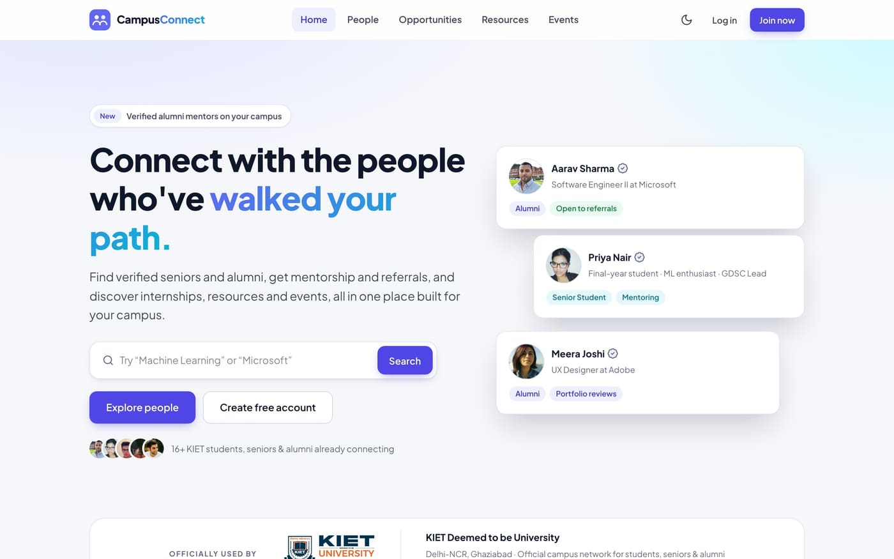
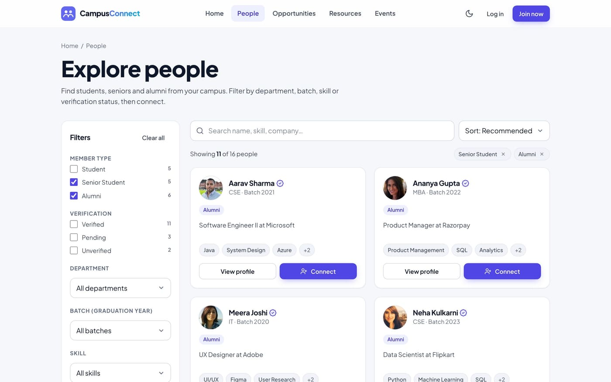
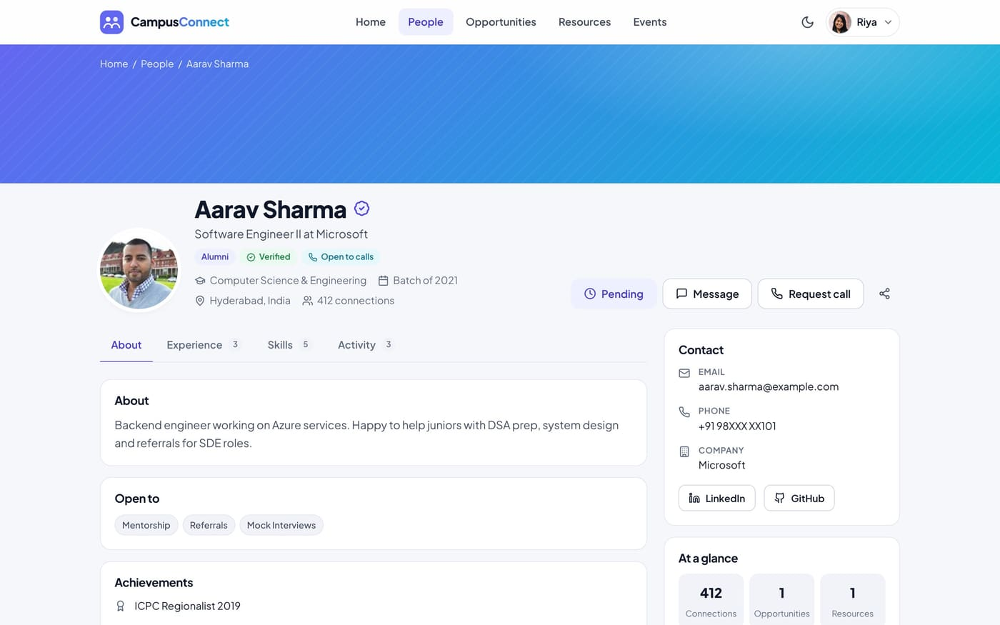
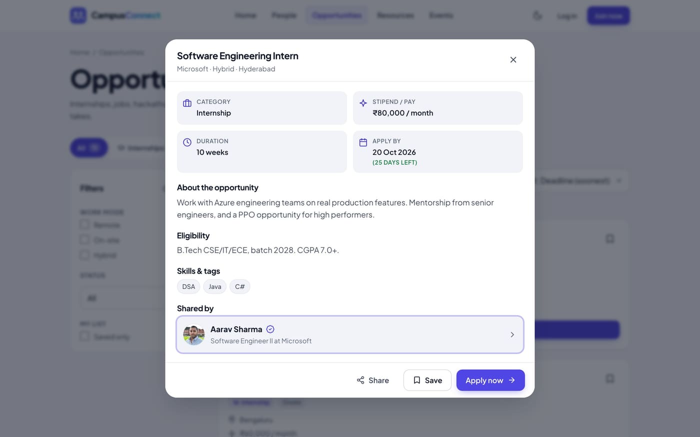
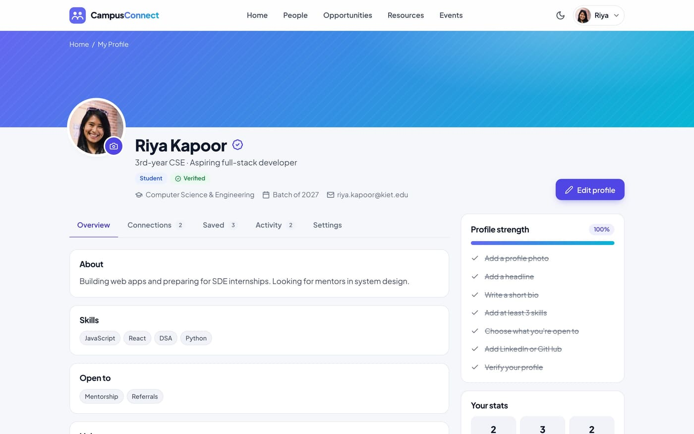
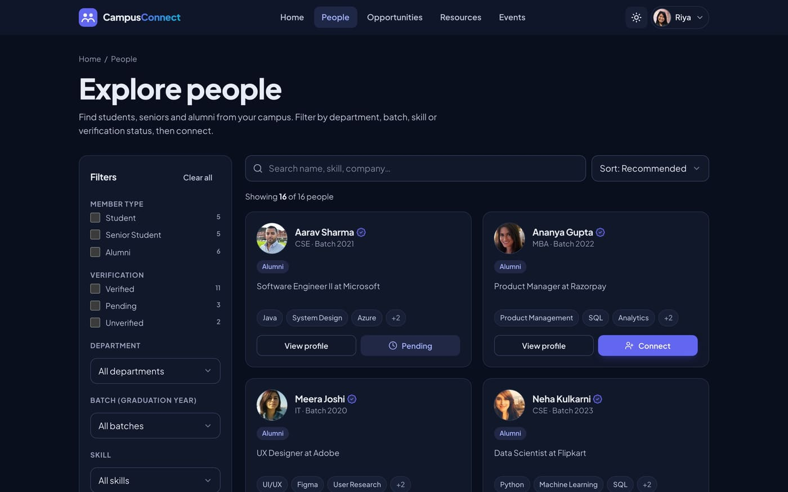
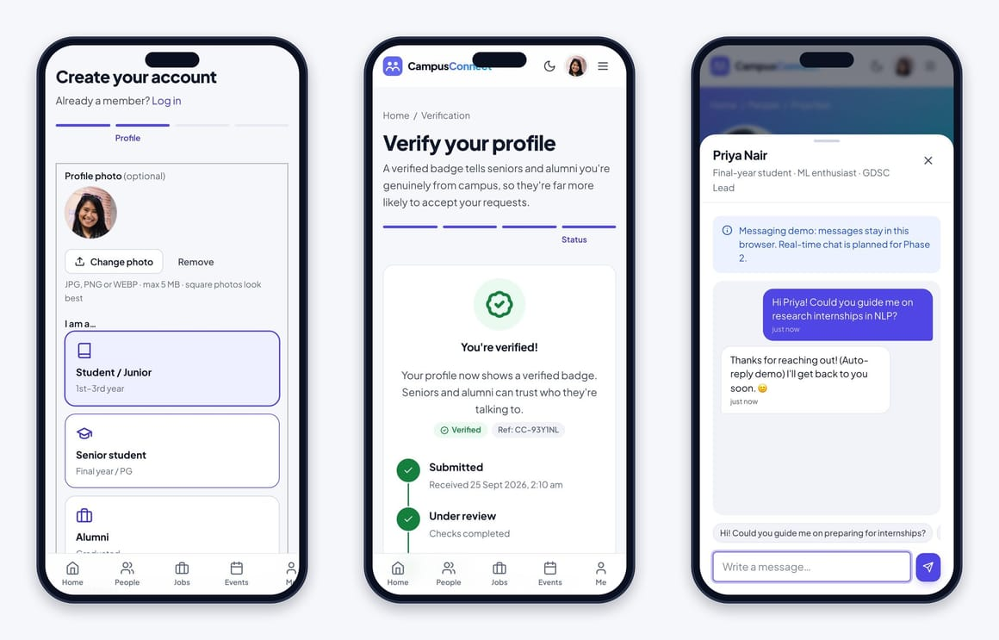

<div align="center">


# Campus Connect

**A social-academic networking platform connecting KIET students, seniors & alumni.**


Synopsis project for **Front End Web Development (26CA205PCB)**, Master of Computer Applications (MCA)
**KIET Deemed to be University**, Delhi-NCR, Ghaziabad

</div>



---

## 👥 Project team

| Name | Roll number | Role |
|---|---|---|
| **Vansh Singh Solanki** | 2628MCA0112 | Project Creator |
| **Vikas Jain** | 2628MCA0311 | Project Creator |
| **Shruti** | 2628MCA0248 | Project Creator |

**Guided by:** Dr. Shashank Bhardwaj, Department of Computer Applications, KIET Deemed to be University
**Submitted:** August 2026

---

## 📌 About the project

Most students still find seniors, mentors and opportunities through WhatsApp groups, notice boards and word of mouth. That information is scattered, impossible to search, and only reaches students who already know the right people.

**Campus Connect** brings all of this into one organised platform. Students can:

- discover **verified seniors and alumni**, and search and filter them by academic year, department, skill and verification status
- open detailed **profiles** and **connect**, **message** or **request a call**
- explore an **opportunities board** (internships, jobs, hackathons, certifications)
- browse a **resource library** (notes, question papers, roadmaps, courses) and **campus events**
- go through **registration**, **verification** and **login** workflows

> **Phase 1 scope (current):** a front-end prototype built with **HTML5, CSS3 and vanilla JavaScript**.
> There is **no backend, database or real authentication** yet. All profiles, opportunities, resources and events are **sample data** (`assets/js/data.js`). Login, registration, verification, connecting and messaging are **UI demos** whose data is saved only in the browser (`localStorage`).

---

## ✨ Features (Phase 1)

| Use case | What you can do |
|---|---|
| Browse profiles | Directory of sample student, senior and alumni profiles with real photos |
| Search / filter profiles | Keyword search plus filters for member type, verification, department, batch and skill, with sorting. Filters stay in the URL, so a filtered view can be shared |
| View profile detail | Tabs for About, Experience, Skills and Activity. **Connect** (with a note), **Message** (demo chat) and **Request a call** (voice/video, date, time slot) |
| Register (demo) | 4-step wizard: account, profile (with **photo upload**), preferences, review. Includes validation, a password-strength meter and draft autosave |
| Verify profile (demo) | College-email OTP, ID card upload or certificate upload, then a status tracker |
| Login (demo) | Form validation, show/hide password, redirect back to the page you came from |
| Browse opportunities | Category tabs with counts, deadline countdown, save, and Apply (demo) |
| Browse resources | Filter by type, department and subject; open the source or download |
| Browse events | Filter by type, mode and upcoming/past; Register (demo) and **Add to calendar (.ics)** |

**Also included:** a My Profile dashboard (photo, completion meter, connections, saved items, activity, settings), light and dark themes, a mobile bottom tab bar, toast notifications, and About, Contact, FAQ, Privacy, Terms, **404**, **Thank you** and Coming-soon pages.

---

## 🖼️ Screenshots

| People directory | Profile detail |
|---|---|
|  |  |
| **Opportunity detail** | **My Profile dashboard** |
|  |  |
| **Dark mode** | **Mobile: Register · Verify · Chat** |
|  |  |

---

## ▶️ How to run

No installation or build step is needed.

**Option 1:** double-click `index.html` to open it in Chrome, Edge or Firefox.

**Option 2** (recommended): run a local server from the project folder.
```bash
python3 -m http.server 5500
# open http://localhost:5500
```
You can also use the VS Code **Live Server** extension.

| Demo detail | Value |
|---|---|
| Login | Click **“Use demo account”**, or use any email plus a password of 8+ characters |
| College-email verification code (OTP) | `246810` |
| Reset demo data | My Profile → Settings → **Reset demo activity** |

---

## 🗂️ Project structure

```
campus-connect-kiet/
├── index.html                 # Home
├── people.html                # Explore people (search + filters)
├── profile.html               # Profile detail  (profile.html?id=p001)
├── my-profile.html            # Logged-in user's dashboard
├── opportunities.html  resources.html  events.html
├── register.html  verify.html  login.html
├── about.html  contact.html  faq.html  privacy.html  terms.html
├── thank-you.html  404.html  coming-soon.html
├── assets/
│   ├── css/style.css          # Design tokens → base → components → pages (light & dark)
│   ├── js/data.js             # SAMPLE DATA ONLY (profiles, opportunities, resources, events)
│   ├── js/app.js              # Core: api layer, store, auth (demo), UI kit, forms, listing engine, layout
│   ├── js/components.js       # Shared cards + Connect / Message / Call / Apply / Register modals
│   ├── js/pages/*.js          # One small controller per page
│   └── img/                   # Logo, KIET logo, sample profile photos
├── docs/screenshots/          # Images used in this README
├── presentation/              # Project presentation (.pptx)
├── site.webmanifest  robots.txt  .nojekyll
└── README.md
```

---

## 🏗️ Architecture

```
HTML pages  ──►  page controllers (pages/*.js)  ──►  app.js · components.js
                                                         │
                                                         ▼
                                           CC.api  (Promise-based service layer)
                                                         │
                          Phase 1 ─► data.js (sample data)      Phase 2 ─► Node.js / Express API
```

- **Data is separated from display logic.** Pages never read `data.js` directly; they call `CC.api.profiles.list()` and similar functions. In Phase 2 only `CC.api` changes to call `fetch('/api/...')`, and the pages stay the same.
- **Classic scripts under one namespace (`window.CC`)**, so the site works both from `file://` and on GitHub Pages.
- **Shared layout:** the header, mobile drawer, bottom navigation and footer are rendered once.
- **Accessible and responsive:** mobile-first layout (640, 900 and 1200 px breakpoints), labelled forms, focus-trapped dialogs, keyboard-navigable tabs, `aria-live` updates and `prefers-reduced-motion` support.

---

## 🧰 Technology stack

| Category | Phase 1 (current) | Phase 2 (planned) |
|---|---|---|
| Frontend | HTML5, CSS3, Vanilla JavaScript | Possible migration to React |
| Design | Figma | – |
| Fonts | Google Fonts (Plus Jakarta Sans) | – |
| Backend | Not implemented | Node.js, Express.js |
| Database | Sample data via `data.js` | MongoDB or Firebase Firestore |
| Authentication | UI demo only | Firebase Authentication |
| File storage | Not implemented | Firebase Storage |
| Version control | Git, GitHub | Git, GitHub |
| Deployment | GitHub Pages | Vercel / Render / Railway |

---

## 🔁 Git workflow & commit process

### 1. Clone the repository
```bash
git clone https://github.com/vanshsinghsolanki/campus-connect-kiet.git
cd campus-connect-kiet
```

### 2. Set your identity for this repository
Every team member commits under their **own** name and the email linked to their GitHub account, so contributions appear on the right profile:
```bash
git config user.name  "Your Full Name"
git config user.email "your-github-email@example.com"
git config user.name && git config user.email      # verify
```
> Tip: to keep your email private, use your GitHub no-reply address from
> *GitHub → Settings → Emails* (`<id>+<username>@users.noreply.github.com`).

### 3. Log in to GitHub (first time on a machine)
Pushing requires **write access** to this repository (the owner, or a collaborator added under *Settings → Collaborators*).
```bash
gh auth login              # GitHub CLI: choose GitHub.com → HTTPS → login with a web browser
gh auth setup-git          # let git use this login when pushing
gh auth status             # check which account is active
```
If the machine is already logged in to a different GitHub account:
```bash
gh auth login              # add the second account
gh auth switch             # choose the account to use
```
*Without the GitHub CLI:* when `git push` asks for a password, paste a **Personal Access Token** (GitHub → Settings → Developer settings → Tokens, with `repo` scope). Your account password won't work.

### 4. Work on a branch, then commit
```bash
git pull origin main                         # start from the latest code
git checkout -b feature/short-description    # e.g. feature/event-filters
# ...make your changes...
git status                                   # review what changed
git add <files>                              # or: git add .
git commit -m "Add event type filter chips"
```
**Commit message style:** short imperative summary (≤ 72 characters), for example:
`Add …` · `Fix …` · `Update …` · `Refactor …` · `Docs: …`

### 5. Push and open a Pull Request
```bash
git push -u origin feature/short-description
```
Then open a **Pull Request** on GitHub into `main`. Another team member reviews it and merges it.

### 6. Deploy to GitHub Pages
*Repository → Settings → Pages → Source: Deploy from a branch → `main` / `(root)` → Save.*
The site will be live at **https://vanshsinghsolanki.github.io/campus-connect-kiet/** and updates automatically on every push to `main`.

---

## 🔭 Future scope (Phase 2)

- Real user accounts with **Firebase Authentication**
- **Node.js + Express** REST APIs and a **MongoDB / Firestore** database
- Persisted **connection requests**, **real-time messaging** and **notifications**
- **Admin dashboard** for profile verification and content moderation
- Verified users can **post opportunities** and **upload resources**
- API-driven search and filtering; a possible migration to **React**

---

## 🙏 Credits & references

- **Sample profile photos:** placeholder portraits from [randomuser.me](https://randomuser.me) (free for use in projects), stored locally. They'll be replaced by real member photos in Phase 2.
- **KIET logo:** property of KIET Deemed to be University, used to identify the institution this academic project is built for.
- **Font:** [Plus Jakarta Sans](https://fonts.google.com/specimen/Plus+Jakarta+Sans) (Google Fonts). **Icons:** inline SVG in the Lucide style.
- **References:** [MDN Web Docs](https://developer.mozilla.org/) (HTML, CSS, JavaScript) · [W3C WCAG](https://www.w3.org/WAI/standards-guidelines/wcag/) · [Figma docs](https://help.figma.com) · [Git docs](https://git-scm.com/doc) · [GitHub Pages docs](https://docs.github.com/en/pages) · [Firebase docs](https://firebase.google.com/docs) (Phase 2)

---

<div align="center">

Made with 💜 by **Vansh Singh Solanki**, **Vikas Jain** and **Shruti**
MCA, KIET Deemed to be University · 2026

</div>
