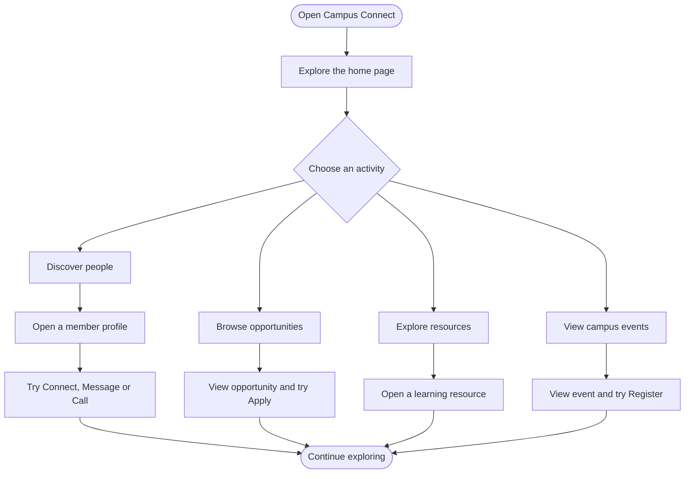
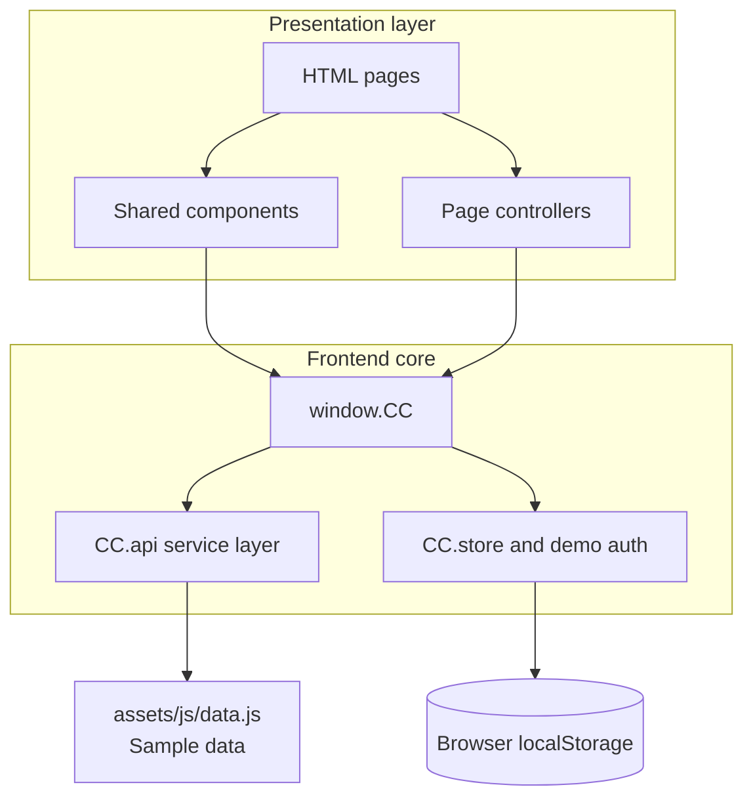
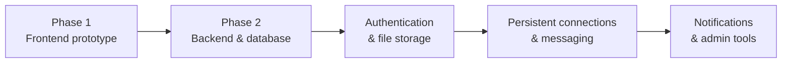

<div align="center">


# Campus Connect

### Your campus network. One connected space.

**Discover people. Learn from seniors. Find opportunities. Stay connected.**

<p>
  
  
  
</p>

<p>
  <a href="https://vanshsinghsolanki.github.io/campus-connect-kiet/">Deployment URL</a> ·
  <a href="https://github.com/vanshsinghsolanki/campus-connect-kiet">Source Code</a> ·
  <a href="#-getting-started">Run Locally</a>
</p>

**An individual academic project** for Front End Web Development (**26CA205PCB**)  
Master of Computer Applications (MCA) · KIET Deemed to be University · 2026

</div>

<p align="center">
  
</p>

---

## ✦ Project at a glance

| | |
|---|---|
| **Project** | Campus Connect |
| **Project type** | Individual academic project |
| **Creator** | Vansh Singh Solanki |
| **Roll number** | 2628MCA0112 |
| **Programme** | Master of Computer Applications (MCA) |
| **Institution** | KIET Deemed to be University |
| **Course** | Front End Web Development |
| **Course code** | 26CA205PCB |
| **Current phase** | Phase 1 — Frontend prototype |
| **Primary technologies** | HTML5, CSS3, Vanilla JavaScript |
| **Hosting target** | GitHub Pages |

> **Project status:** This repository currently contains a frontend prototype. The interface demonstrates user journeys with sample data and browser-local demo state. A production backend, database and real authentication have not been implemented.

---

## ✧ Navigate the project

| Section | Section | Section |
|:--|:--|:--|
| [Overview](#-overview) | [Problem & solution](#-problem--solution) | [Features](#-features) |
| [Screenshots](#-screenshots) | [User journey](#-user-journey) | [Architecture](#-architecture) |
| [Technology stack](#-technology-stack) | [Project structure](#-project-structure) | [Getting started](#-getting-started) |
| [Demo guide](#-demo-guide) | [Roadmap](#-roadmap) | [Limitations](#-scope--limitations) |
| [Individual project details](#-individual-project-details) | [Workflow](#-development-workflow) | [Credits](#-credits--references) |

---

## 📄 Project documents

The individual academic synopsis and project presentation are available below.

| Document | Description | Link |
|---|---|---|
| **Project synopsis** | Individual submission version, revised from the earlier synopsis while preserving the project scope and technical details. | [Read synopsis](docs/Campus-Connect-Individual-Synopsis.md) |
| **Project presentation** | Campus Connect project slide deck (.pptx). | [View / download presentation](presentation/Campus-Connect-Presentation.pptx) |

## 🎯 Overview

Campus Connect is a social-academic networking platform concept designed around the needs of students, seniors and alumni at KIET. It brings people discovery, mentorship-oriented connections, opportunities, learning resources and campus events into one organised interface.

Instead of depending entirely on scattered messages, informal groups and word of mouth, students can explore a searchable directory, view member profiles and browse curated sections for opportunities, resources and events.

### The idea

**One campus community. Multiple ways to grow.**

- Find seniors and alumni by department, batch, skills and verification status.
- Explore profile information and try the connect, message and call-request experiences.
- Discover internships, jobs, hackathons and certifications.
- Browse learning resources such as notes, roadmaps, courses and question papers.
- Explore campus events and try the registration and calendar experiences.

## 💡 Problem & solution

<table>
<tr>
<th width="50%">The problem</th>
<th width="50%">The proposed solution</th>
</tr>
<tr>
<td valign="top">

- Useful information is spread across multiple groups and channels.
- Students may not know which seniors or alumni to approach.
- Opportunities and learning resources can be difficult to discover later.
- There is no single searchable place for these campus connections.

</td>
<td valign="top">

- A central people directory with search and filters.
- Detailed profiles to help students discover relevant contacts.
- Dedicated spaces for opportunities and learning resources.
- An events area for campus activities and participation.

</td>
</tr>
</table>

---

## ✨ Features

The following features are implemented as **Phase 1 frontend experiences**. Actions that would normally require a server are demonstrations only.

<table>
<tr>
<th width="34%">Feature area</th>
<th>What the prototype includes</th>
</tr>
<tr>
<td><strong>👥 People directory</strong></td>
<td>Browse sample student, senior and alumni profiles. Search by keyword and filter by member type, verification status, department, batch and skill. Sorting and URL-synchronised filters are included.</td>
</tr>
<tr>
<td><strong>🪪 Member profiles</strong></td>
<td>Profile details with About, Experience, Skills and Activity tabs, plus demo Connect, Message and Request a Call interactions.</td>
</tr>
<tr>
<td><strong>📝 Registration</strong></td>
<td>A four-step registration wizard covering account details, profile information, preferences and review. Includes form validation, photo selection, password-strength feedback and draft autosave.</td>
</tr>
<tr>
<td><strong>🔐 Verification demo</strong></td>
<td>College-email OTP and document-upload interface with a verification status tracker. No real identity verification service is connected.</td>
</tr>
<tr>
<td><strong>🔑 Login demo</strong></td>
<td>Login form validation, show/hide password and return navigation. Authentication is simulated in the browser.</td>
</tr>
<tr>
<td><strong>💼 Opportunities</strong></td>
<td>Browse internships, jobs, hackathons and certifications through category tabs, deadline indicators, saved items and demo Apply actions.</td>
</tr>
<tr>
<td><strong>📚 Resource library</strong></td>
<td>Browse sample notes, videos, e-books, roadmaps, question papers and courses with type, department and subject filters.</td>
</tr>
<tr>
<td><strong>📅 Campus events</strong></td>
<td>Browse events by type, mode and date; try the demo registration flow and export calendar entries as <code>.ics</code> files.</td>
</tr>
<tr>
<td><strong>🧑‍💻 My Profile dashboard</strong></td>
<td>Profile photo, completion meter, connections, saved items, activity and settings in a dashboard-style experience.</td>
</tr>
<tr>
<td><strong>🎨 Interface & accessibility</strong></td>
<td>Responsive layouts, light and dark themes, mobile navigation, toast messages, labelled forms, keyboard-friendly interactions and reduced-motion support.</td>
</tr>
</table>

**Additional pages:** About, Contact, FAQ, Privacy, Terms, Thank You, Coming Soon and custom 404 pages.

---

## 🖼️ Screenshots

A look at the current frontend prototype.

<table>
<tr>
<td width="50%">
<strong>Home page</strong><br>

</td>
<td width="50%">
<strong>People directory</strong><br>

</td>
</tr>
<tr>
<td>
<strong>Member profile</strong><br>

</td>
<td>
<strong>Opportunity detail</strong><br>

</td>
</tr>
<tr>
<td>
<strong>My Profile dashboard</strong><br>

</td>
<td>
<strong>Dark theme</strong><br>

</td>
</tr>
<tr>
<td colspan="2">
<strong>Mobile experience</strong><br>

</td>
</tr>
</table>

---

## 🔄 User journey

The prototype is organised around a simple journey from discovery to participation.



---

## 🏗️ Architecture

The current application uses a framework-free, layered frontend structure. HTML pages load shared scripts and a page-specific controller. The controllers use the shared `window.CC` namespace and its Promise-based service layer.



### Architecture notes

- **Separation of concerns:** sample data is kept in `assets/js/data.js`; page controllers handle page-specific behaviour.
- **Shared application namespace:** `window.CC` exposes utilities, UI helpers, forms, layout, demo state and the data service layer.
- **Promise-based service layer:** pages use `CC.api` methods rather than directly rendering from the sample-data file.
- **Browser-only demo persistence:** `CC.store` uses namespaced `localStorage` for demo activity and state.
- **Future integration point:** the service layer is intended to be the boundary for a future API-backed implementation.

---

## 🧰 Technology stack

| Area | Phase 1 — implemented | Phase 2 — planned |
|---|---|---|
| Frontend | HTML5, CSS3, Vanilla JavaScript | React may be evaluated |
| Styling & design | Custom CSS design system | Component-based UI system |
| Typography | Plus Jakarta Sans via Google Fonts | To be decided |
| Icons | Inline SVG icons | To be decided |
| Data | JavaScript sample data | MongoDB or Firebase Firestore |
| Backend | Not implemented | Node.js, Express.js |
| Authentication | Browser-only demo flow | Firebase Authentication |
| File storage | Local browser interaction only | Firebase Storage |
| Version control | Git and GitHub | Git and GitHub |
| Hosting | GitHub Pages deployment target | Vercel, Render or Railway may be evaluated |

---

## 📁 Project structure

The following is a simplified view of the repository's current structure.

```text
campus-connect-kiet/
├── index.html
├── people.html
├── profile.html
├── my-profile.html
├── opportunities.html
├── resources.html
├── events.html
├── register.html
├── verify.html
├── login.html
├── about.html
├── contact.html
├── faq.html
├── privacy.html
├── terms.html
├── thank-you.html
├── coming-soon.html
├── 404.html
│
├── assets/
│   ├── css/
│   │   └── style.css
│   ├── js/
│   │   ├── data.js
│   │   ├── app.js
│   │   ├── components.js
│   │   └── pages/
│   │       ├── home.js
│   │       ├── people.js
│   │       ├── profile.js
│   │       ├── my-profile.js
│   │       ├── opportunities.js
│   │       ├── resources.js
│   │       ├── events.js
│   │       ├── register.js
│   │       ├── verify.js
│   │       └── login.js
│   └── img/
│       ├── favicon.svg
│       ├── brand/
│       └── avatars/
│
├── docs/
│   └── screenshots/
│       ├── home.jpg
│       ├── people.jpg
│       ├── profile.jpg
│       ├── opportunity.jpg
│       ├── my-profile.jpg
│       ├── dark-mode.jpg
│       └── mobile.jpg
│
├── presentation/
│   └── Campus-Connect-Presentation.pptx
│
├── site.webmanifest
├── robots.txt
├── .nojekyll
└── README.md
```

---

## 🚀 Getting started

No package installation or build process is required for the current static frontend.

### Prerequisites

- Git
- Python 3 (for the optional local HTTP server), or the VS Code Live Server extension
- A modern browser such as Chrome, Edge or Firefox

### 1. Clone the repository

```bash
git clone https://github.com/vanshsinghsolanki/campus-connect-kiet.git
cd campus-connect-kiet
```

### 2. Run a local server

Recommended:

```bash
python3 -m http.server 5500
```

### 3. Open the application

Visit:

```text
http://localhost:5500
```

You can also open `index.html` directly in a browser. A local HTTP server is recommended for a more consistent development experience.

---

## 🧪 Demo guide

| Demo item | How to try it |
|---|---|
| Explore profiles | Open **People** and use the search and filters. |
| Profile interactions | Open a profile and try Connect, Message or Request a Call. |
| Registration | Open **Register** and move through the four-step form. |
| Login | Use the demo account option, or enter an email and a password of at least 8 characters. |
| Verification | The sample college-email OTP is `246810`. |
| Opportunities | Open an opportunity and try the save or Apply interaction. |
| Events | Open an event and try Register or Add to Calendar. |
| Reset local demo activity | Open My Profile → Settings → **Reset demo activity**. |

> **Important:** These are demonstration flows. Do not enter real passwords, personal documents or sensitive information. Demo data and activity are stored in the browser, not in a secure production account.

---

## 🗺️ Roadmap

The next phase is planned as a move from a static prototype to a connected application.



### Phase 2 — planned enhancements

- [ ] Design and implement a Node.js + Express REST API.
- [ ] Connect a persistent database using MongoDB or Firebase Firestore.
- [ ] Add real authentication and protected user sessions.
- [ ] Implement secure profile and document storage.
- [ ] Persist connection requests and user activity.
- [ ] Build real-time messaging and notifications.
- [ ] Add an admin dashboard for verification and content moderation.
- [ ] Allow authorised users to publish opportunities and resources.
- [ ] Evaluate a React-based frontend as the application grows.
- [ ] Add automated testing, deployment checks and production security controls.

*Roadmap items are proposed future work; they are not part of the current Phase 1 implementation.*

---

## 🔒 Scope & limitations

Transparency matters: the current build is a frontend prototype intended to demonstrate the product concept and user experience.

- **No production backend:** there is no Node.js or Express server in the current implementation.
- **No production database:** profiles, opportunities, resources and events are sample data stored in `assets/js/data.js`.
- **No real authentication:** login and registration are UI demonstrations, not secure account creation or sign-in.
- **No live verification:** OTP and document-upload screens do not connect to an identity-verification provider.
- **No server-side messaging:** connect, message, call-request, apply and event-registration actions are demo interactions.
- **Browser-local state:** demo activity is stored in `localStorage` and is limited to the current browser environment.
- **Sample content:** profile names, biographies, images and listings are demonstration content, not a live institutional directory.

Campus Connect is an independent academic project created for learning and demonstration. It is not presented here as an officially operated or endorsed KIET platform.

---

## 👨‍💻 Individual project details

| Detail | Information |
|---|---|
| Project creator | **Vikas Jain** |
| Roll number | **2628MCA0311** |
| Programme | Master of Computer Applications (MCA) |
| Institution | KIET Deemed to be University |
| Course | Front End Web Development |
| Course code | 26CA205PCB |
| Academic year | 2026 |
| Project type | Individual academic project |

### Development workflow

The project is maintained as an individual repository. Git is used to track changes and GitHub is used for source control and hosting.

Typical workflow:

1. Make a focused change to the project.
2. Run the website locally and test the affected pages.
3. Review the changed files with `git status`.
4. Commit the work with a clear message.
5. Push the changes to the GitHub repository.
6. Check the hosted version after deployment.

Example commands:

```bash
git status
git add README.md
git commit -m "Docs: redesign individual project README"
git push origin main
```

---

## 🙏 Credits & references

- **Sample profile portraits:** [Random User Generator](https://randomuser.me/) — sample portrait imagery used in the prototype.
- **Institutional identity asset:** KIET logo asset is included to identify the academic context of the project. KIET retains ownership of its institutional marks.
- **Typography:** [Plus Jakarta Sans](https://fonts.google.com/specimen/Plus+Jakarta+Sans), served through Google Fonts.
- **Frontend documentation:** [MDN Web Docs](https://developer.mozilla.org/).
- **Accessibility reference:** [W3C Web Accessibility Initiative](https://www.w3.org/WAI/).
- **Design reference:** [Figma Help Center](https://help.figma.com/).
- **Version control:** [Git documentation](https://git-scm.com/doc).
- **Hosting reference:** [GitHub Pages documentation](https://docs.github.com/en/pages).
- **Future backend reference:** [Firebase documentation](https://firebase.google.com/docs).

---

<div align="center">

### Built with curiosity, code and a campus-first idea 💜

**Campus Connect**  
An individual academic project by **Vansh Singh Solanki**  
MCA · KIET Deemed to be University · 2026

[Back to top](#campus-connect)

</div>
